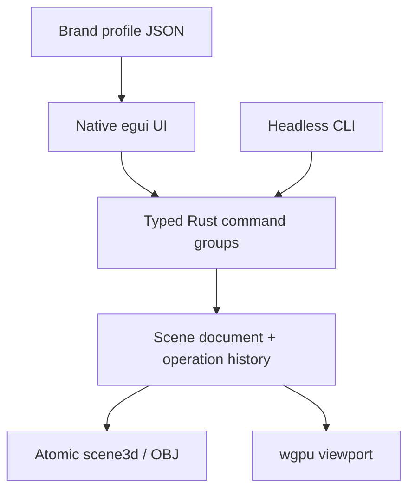

# 3d-editor architecture

## Intent & Constraints

Independent Rust-authored 3D application. The user explicitly chooses a long-term native replacement over relying on Blender as its implementation. First milestone is an editable polygon scene, not modeling/animation/rendering parity. No Blender, Python or JavaScript process is required to open, edit or save a scene. OS window/GPU drivers remain platform dependencies.

## Dependency & Contract Matrix

| Component | Authority | Dependencies |
|---|---|---|
| scene / mesh | versioned objects, transforms, topology and materials | serde, glam, UUID |
| commands | validated grouped mutations, journal, undo/redo | scene |
| persistence / OBJ | atomic scene files, bounded interchange | scene |
| camera | orbit/pan/zoom, projection, ray picking | glam, scene |
| branding | application identity only, external JSON profile | serde |
| renderer | wgpu depth-tested viewport, flat lighting and grid | eframe/egui-wgpu |
| ui | startup, scene tree, inspector, commands and history | shared Rust model |

## Invariants

One authoritative scene model for headless and GUI. No UI-only mutation of geometry. Preview gestures produce one committed undo group. Failed batches leave scene/history/revision unchanged. Revisions increase across undo/redo. Persistent history records user-declared actor/task and observed object differences, not model reasoning or authenticated identity.

Iteration 0002: selection.rs handles pixel-space vertex/edge picks with transformed scene geometry and surface occlusion; renderer markers do not change document state. Inset is centroid-factor interpolation, subdivision is linear and reuses shared edge midpoints. Point/edge movement triangulates affected polygons in the same validated command to retain planar faces; the journal captures topology changes. Whole-mesh subdivision clears transient element selection because face/edge indices change. Stable element IDs, multiselection and distributed selection remain future contracts.

Editor document is a new specialized native source, not a second mirror of creative-core's flat layer/note schema. Suite membership/references later wrap this native document via stable IDs and versioned artifacts. Do not automatically migrate or overwrite old .blend assets. No live Suite graph integration is claimed in v0.1.

Brand profile controls launch presentation, mark, application title, accent and workspace signature; it never changes object materials, saved geometry or imported art. Neutral default name is exactly `3d-editor`. No mandatory timed splash or artificial startup delay. Distinctive brand may later occupy the start hero and one persistent identity anchor while controls and content stay readable.

## Refactoring Guides

Changed commands require schema/file compatibility tests, headless and UI updates. New mesh operations need geometric validation and export fixtures. Renderer must draw from validated scene geometry; no separate render-only object state. Changing the scene file schema requires explicit version handling and migration. Plugin/mobile/distributed collaboration are future milestones, not implied by eframe portability.
