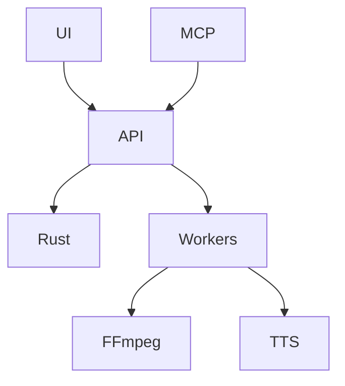

# K-Creative architecture

## Intent & Constraints
Shared creative workspace /storage/Public/K-Dev/Projekte/K-Creative-Cloud. Existing Electron shell and Python studio remain compatible. New edit-state logic uses Rust; Python wraps mature media runtimes. Never overwrite existing user modifications.

## Dependency & Contract Matrix
- creative-core/: Rust persisted project/action/undo authority.
- studio/creative_api.py: HTTP jobs, upload, path confinement and serialized core invocations.
- studio/creative_media.py: Pillow/FFmpeg/audio/TTS render adapters.
- studio/static/creative/: shared DAW/photo/video UI dispatching canonical commands.
- studio/creative_mcp.py: MCP stdio bridge to the same HTTP actions.
- studio/server.py: existing APIs plus additive /creative workspace.
Contract: docs/creative-native/CONTRACT.md. GUI and MCP must not maintain separate authoritative state.

## Dependency Graph

## Invariants
Validated typed commands; atomic saves; no media shell interpolation; explicit unavailable capabilities; source assets preserved; undo for GUI/MCP. Local server binds loopback.

## Refactoring Guides
Update contract, core schemas, UI and tests together for changed actions. Keep older APIs intact. Blender compositions remain external editable sources; render adapters must surface unavailable engine errors.

## Creative skill discovery

Output skills use scripts/creative_tools.py for kind-filtered adapter discovery; packages/integrations JSONs are inert metadata. Candidate engines require review and representative tests, and accepted still requires runtime probe. Canonical recording adapter: packages/screen-recording/tutorial.py. K-AI launchers preserve former entrypoints. No second project-state authority.

Shared discovery implementation: studio/creative_discovery.py. scripts/creative_tools.py is a compatibility CLI; GET /api/creative/workflows and MCP creative_workflows expose the same inventory to the dashboard and agents. No editor state or runtime readiness is inferred from discovery.
