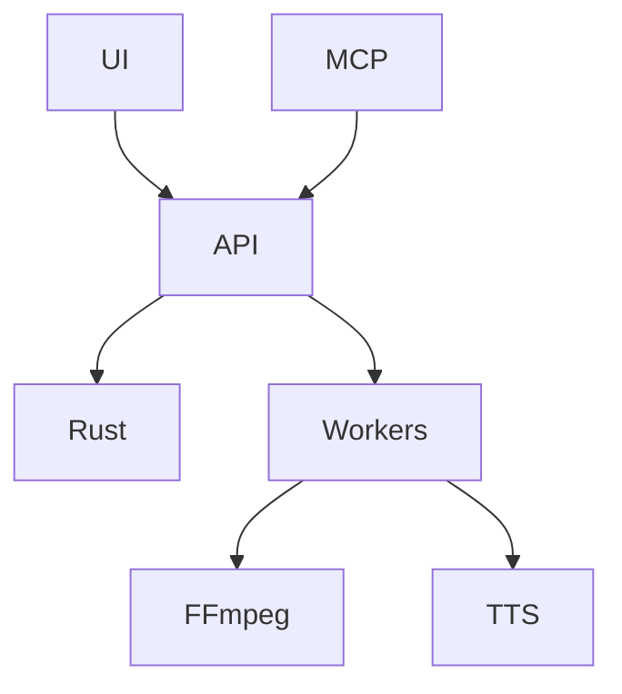

# K-Creative architecture

## Intent & Constraints
Shared creative workspace /storage/Public/K-Dev/Projekte/K-Creative-Cloud. Existing Electron shell and Python studio remain compatible. New edit-state logic uses Rust; Python wraps mature media runtimes. Never overwrite existing user modifications.

## Dependency & Contract Matrix
- creative-core/: Rust persisted project/action/undo authority.
- studio/creative_api.py: HTTP jobs, upload, path confinement and serialized core invocations.
- studio/creative_media.py: Pillow/FFmpeg/audio/TTS render adapters.
- studio/static/creative/: shared DAW/photo/video UI dispatching canonical commands.
- studio/creative_mcp.py: MCP stdio bridge to the same HTTP actions.
- studio/server.py: existing APIs plus additive /creative workspace.
Contract: docs/creative-native/CONTRACT.md. GUI and MCP must not maintain separate authoritative state.

## Dependency Graph

## Invariants
Validated typed commands; atomic saves; no media shell interpolation; explicit unavailable capabilities; source assets preserved; undo for GUI/MCP. Local server binds loopback.

## Refactoring Guides
Update contract, core schemas, UI and tests together for changed actions. Keep older APIs intact. Blender compositions remain external editable sources; render adapters must surface unavailable engine errors.

## Creative skill discovery

Output skills use scripts/creative_tools.py for kind-filtered adapter discovery; packages/integrations JSONs are inert metadata. Candidate engines require review and representative tests, and accepted still requires runtime probe. Canonical recording adapter: packages/screen-recording/tutorial.py. K-AI launchers preserve former entrypoints. No second project-state authority.

Shared discovery implementation: studio/creative_discovery.py. scripts/creative_tools.py is a compatibility CLI; GET /api/creative/workflows and MCP creative_workflows expose the same inventory to the dashboard and agents. No editor state or runtime readiness is inferred from discovery.

## Integrated assistant and branding

studio/creative_assistant.py plans data-only actions through Codex/Claude/Qwen CLI, compatible API or Ollama. Speech uses local configured Whisper; sketches are explicit references. creative_assistant_api.py shares jobs/state with creative_api.py; Rust project.batch commits one revision with one undo and an expected_revision guard. creative_primitives.py runs fixed Blender recipes for editable sources and previews. No generated scripts run.

Brand identity remains inside project.brand. creative_brand.py validates roles/type/voice/layout/assumptions and writes immutable revision folders with editable identity.json, semantic tokens, CSS, style guide/preview, palette SVG and social-media/brand.json. External tool changes import through the same native brand.update/batch. Existing Piggy token sources are untouched. See ADR 0004/0005.

## Suite documents and program boundaries

Masterplan: docs/suite/MASTERPLAN.md and seven domain subplans. ADR 0006 retains mature Blender/FreeCAD/media engines behind capability-tested adapters, with Rust as the common document/version authority. Separate app surfaces share contracts; they do not require a shared timeline or a universal geometry/audio schema.

creative-core/src/documents.rs owns the optional project-local document graph. Links run dependent -> source. P0 validates acyclic active dependencies and implements read-only archive preview plus revision-guarded, atomic reversible archive modes. Preserving users creates logical local manifest copies and retains upstream links; cascading affects transitive users, not shared inputs. Core action schemas, native CONTRACT, CLI tests and HTTP/MCP integration tests must change together. Preview/archive cannot be nested in batches.

No media file deletion, content-addressed blob store, distributed merge, native-app live sync or mobile/auth/plugin-host implementation is implied by this graph. Current JSON persistence still rewrites metadata snapshots. Keep the planner allowlist unchanged until lifecycle UI/authorization and broader adapter guarantees are ready.

## Independent native 3D editor

The user's subsequent explicit direction is a Rust-native replacement, starting with `3d-editor/` (ADR 0007). This crate owns its specialized scene document, mesh geometry, commands, persistent history and GPU viewport. It runs independently of Blender/Python/JS; old Blender/FreeCAD workflows remain available. The native scene is a future Suite source artifact, not a synchronized duplicate of creative-core's layer/note model. No live adapter is implied yet.

Read `3d-editor/ARCHITECTURE.md` before changing scene/command/renderer contracts. Branding profiles affect application/startup/workspace identity only, never scene colors or geometry. UI and CLI use the same Rust command authority.
