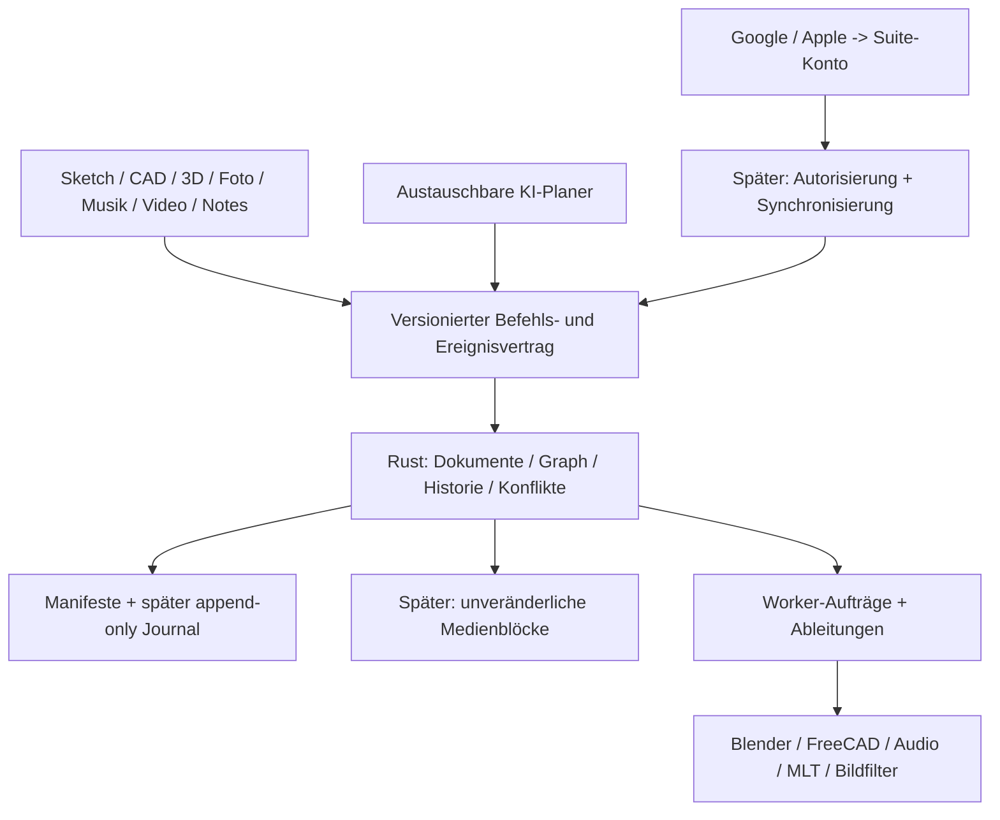

# K-Creative Suite — Masterplan

Stand: 12. November 2026. Ziel: eigenständige, eng verbundene Programme für Desktop und iPad, optional als gemeinsame Suite. Gemeinsame Quellen, Versionen, Konto und KI; fachgerechte Arbeitsflächen statt einer universellen Timeline.

**Nachfolgende Richtungsänderung:** Langfristiges Ziel sind eigene Rust-Anwendungen für die Fachprogramme; der ausdrücklich gewählte erste Neubau ist `3d-editor/`. Für dessen Neuentwicklung gilt [ADR 0007](../adr/0007-independent-rust-3d-editor.md). Die frühere reine Anbindungsstrategie unten beschreibt jetzt Übergangs- und Kompatibilitätsworkflows. Weitere Fachprogramme werden nach dem ersten 3D-Durchstich einzeln spezifiziert, statt ihre vollständige Neuentwicklung vorzutäuschen. Umfang und Ausbau des neuen Editors: [Roadmap](../../3d-editor/ROADMAP.md).

## Produktentscheidungen

1. Rust bleibt gemeinsame Autorität für Dokumentgraph, Bearbeitungsbefehle, Versionen und spätere Zusammenarbeit. Bestehende Python/Electron/Web-Komponenten bleiben während der Migration nutzbar.
2. Reife Fachprogramme anbinden: Blender für Mesh/Animation/Cloth/Rendering; FreeCAD für bemaßte Skizzen, Constraints, B-Rep und technische Zeichnungen. Keine Neuentwicklung dieser Engines und kein pauschaler Rust-Rewrite fremder C/C++-Projekte.
3. Eigene Apps können Fenster, Startsymbole und Pakete trennen, teilen aber Bibliotheken, Verträge und Projektzuordnung. Suite und Einzel-App öffnen dieselben Dokumente, ohne Zweitkopien als neue Wahrheit.
4. Native Quelldokumente bleiben erhalten. Abgeleitete Vorschauen/Proxies werden gecacht. Import, Export, verknüpfte Quelle und verlustfreier Roundtrip sind getrennte Fähigkeiten; keine Zusage „alle Formate/alle Funktionen“.
5. Lokale Bearbeitung funktioniert ohne Konto. Google/Apple-Konto verbindet Geräte, geteilte Projekte und optionale Cloud-Jobs. Anmeldung ist keine Gmail-Postfachberechtigung.
6. KI-Befehle laufen headless. Optionale Zeiger sind Ereignisvisualisierungen. Manuelle und KI-Aktionen nutzen denselben Vertrag, aber kein Agent erhält automatisch beliebige Shell-/Plugin-Codeausführung.

## Bestehender Stand und heutiger Einstieg

Vorhanden: Rust-JSON-CLI, persistierte Projektzustände, 100 Undo-Snapshots, atomare Batches und Revision-Guard; eigener Foto/Video/Musik-Workspace; Provideradapter; externe Programmadapter unterschiedlicher Tiefe. Das ist kein vollständiger kollaborativer Editor.

Heutiger Implementierungsumfang: Dokumentmanifeste und gerichtete Abhängigkeiten **innerhalb eines Suite-Projekts**, Zyklusprüfung, read-only Archivvorschau, revisionsgesichertes reversibles Archivieren mit abhängigen Dokumenten oder mit lokalen Kopien bei erhaltenen Nutzern. Keine Mediendateien werden gelöscht. Weitere Funktionen unten sind geplante Milestones.

## Struktur

Ein natives .blend oder .FCStd bleibt beim Adapter die fachliche Quelle; der Suite-Kern kennt Version, Referenzen und nachgewiesene Änderungsfähigkeiten. Ein dauerhaft veränderbarer Dateipfad ist noch keine eingefrorene Version. Erst späterer Blob-Store oder verifiziert unveränderliche Artefakte geben diese Garantie.

## Teilpläne

| Plan | Ergebnis | Abhängigkeiten |
|---|---|---|
| [01 — Dokumente und Lebenszyklus](plans/01-documents.md) | Verknüpfen, Einfrieren, Archivieren, Wiederherstellen | heutiger Start |
| [02 — Verlauf, KI und Zusammenarbeit](plans/02-collaboration.md) | Makro/Mikro-Gruppen, Änderungsbelege, Merge, optionaler Zeiger | Dokumente, Journal |
| [03 — Musik und Plugins](plans/03-audio.md) | Patterns, Routing, Stems, Standard-DSP, VST3/AUv3 | Dokumente, Echtzeit-Audioadapter |
| [04 — Foto, Video, Vektor und Notes](plans/04-media.md) | Fachoberflächen, Filter, Quellenbearbeitung | Dokumente, Adapter |
| [05 — CAD, Blender und Druck](plans/05-cad-3d.md) | Sketch → Extrusion → Revision → Fertigungsdatei | Dokumente, FreeCAD/Blender |
| [06 — Textil und Unreal](plans/06-textile.md) | Vermessung, Schnittteile, Varianten, validierter Engine-Austausch | CAD/3D, Maß-/Einheitenvertrag |
| [07 — Konto, Geräte und Apps](plans/07-platforms.md) | Desktop/iPad, SSO, Suite und Einzelpakete | Dokumente, später Sync/Autorisierung |

## Reihenfolge und realistische Größenordnung

Aufwand in **Personenwochen** für erfahrene Entwicklung, keine Zusage eines Kalendertages oder Funktionsgleichheit mit Adobe. Enthalten sind definierte Funktionen und Tests; Hardware-, Lizenz- und Produktprüfung können Aufwand erhöhen. Teilbereiche überlappen; Zahlen nicht blind addieren.

| Phase | Aufwand grob | Fertig, wenn … |
|---|---:|---|
| P0: Plan + erster Dokumentgraph | diese Sitzung | dokumentierte Verträge und geprüfter Rust-/HTTP-Durchstich |
| P1: Blob-Store, append-only Journal, Gruppen, Lebenszyklus-UI | 4–7 | Löschen mit Vorschau, Referenzkopien, Wiederherstellen und Verlauf auf Echtdaten |
| P2: parallel arbeitender Nutzer/KI, Konflikte, selektives Undo | 5–9 | unabhängige Änderungen erhalten; widersprüchliche Varianten sichtbar; kein stiller Verlust |
| P3: Sketch → CAD → Blender mit Quellenwechsel | 4–8 | Einheiten und Abmessungen geprüft; Quellenänderung erzeugt nachvollziehbare Ableitung |
| P4: eigene Musik/Video/Foto-Workflows | je 3–6 | je ein produktiver End-to-End-Workflow mit definiertem Formatumfang |
| P5: Desktop-Pluginhost und Stems | 6–12 | Audio-Latenz, Plugin-Abstürze, Zustandswiederherstellung, Referenz-Plugins geprüft |
| P6: parametrisches Textil und Engine-Austausch | 8–16+ | reale Maß-/Stoff-Fixtures, Druckkontrolle, eingeschränkter Unreal-Roundtrip |
| P7: Konto/Sync und iPad-Client | 6–12+ | physische Geräte, Offline-Konflikte, sichere Anmeldung und definierte mobile Funktionen |

Eine breite professionelle Suite ist ein längerfristiges Produktvorhaben. Heute startet die gemeinsame Grundlage; Vollparität, beliebige Plugins und alle Formate sind keine Abnahmekriterien.

## Qualitäts- und Freigaberegeln

- Jede Fähigkeit meldet `unsupported`, `import_only`, `export_only`, `linked` oder `roundtrip_verified` für eine getestete Version/Plattform. Unsupported darf nie still verlustbehaftet speichern.
- Referenzdateien pro Format: Inhalt, Maße, Farbe, Zeit, Material/Pluginzustand und Rückimport prüfen. Konvertierungen liefern Verlustbericht.
- Lizenzinventar pro Engine/SDK/Addon/Modell und Distribution, konkrete Versionen und Notices. Separater Prozess ist eine Architekturgrenze, keine automatische Lizenzfreistellung.
- Keine lokalen Datenverluste durch Bereinigung: zunächst Archiv/Tombstone. Physisches Entfernen erst nach Referenz-, Versions- und Sync-Retention-Prüfung; keine Garbage Collection in P0.
- Bestehende Nutzeränderungen nicht überschreiben. Commit/Push/Build ausschliesslich K-Dev-Handover; keine Veröffentlichung oder OAuth-Provider-Konfiguration ohne konkrete Zugangsdaten/Umgebung.

Technische Primärquellen und geprüfte Grenzen: [SOURCES.md](SOURCES.md). Abnahmen: [GATES.md](GATES.md).
